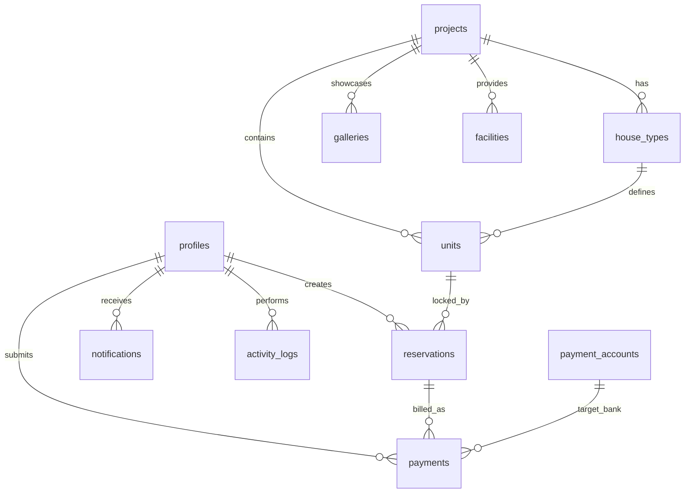

# Dokumentasi Database & Keamanan Supabase — PERUMAHAN

Dokumen ini menjelaskan rancangan skema PostgreSQL, Row Level Security (RLS), fungsi transaksional (RPC) anti double-booking, serta kebijakan Supabase Storage yang berada pada folder `supabase/migrations/`.

---

## 1. Daftar File Migrasi SQL

Jalankan secara berurutan di **Supabase SQL Editor** atau melalui `supabase db push`:

1. `supabase/migrations/0001_initial_schema.sql` — 12 tabel utama + `app_settings`, ENUM, UUID PK, FK, constraint, index, partial unique index anti double-booking, dan trigger `updated_at`.
2. `supabase/migrations/0002_functions_and_locking.sql` — Helper role `SECURITY DEFINER`, trigger auto-create profile (`role = 'customer'`), trigger blokir eskalasi role, proteksi transaksi terkonfirmasi, generator nomor reservasi (`RSV-YYYYMMDD-XXXX`), RPC atomik `create_unit_reservation` (`SELECT ... FOR UPDATE`), `submit_payment_proof`, `verify_manual_payment`, dan `release_expired_reservations`.
3. `supabase/migrations/0003_rls_policies.sql` — Mengaktifkan RLS pada seluruh 13 tabel dengan kebijakan ketat untuk `anon`, `customer`, `sales`, `admin`, dan `super_admin`.
4. `supabase/migrations/0004_storage_buckets.sql` — 5 bucket media publik (`project-images`, `house-images`, `house-floorplans`, `gallery-images`, `banners`) dan 1 bucket privat (`payment-proofs`) berbatas 5 MB dengan kebijakan folder per pengguna dan akses signed URL.
5. `supabase/migrations/0005_seed_initial_data.sql` — Konfigurasi default (`reservation_expiry_hours`, kontak developer) dan contoh rekening bank resmi developer.

---

## 2. Diagram Relasi Antar Tabel (ERD)



---

## 3. Ringkasan 12 Tabel Utama (+ `app_settings`)

| Tabel | Fungsi Utama | Soft Delete | Proteksi Khusus |
| --- | --- | --- | --- |
| `profiles` | Identitas pengguna & role RBAC (`customer`, `sales`, `admin`, `super_admin`) | Ya (`deleted_at`) | Trigger blokir perubahan `role` & `is_active` selain oleh `super_admin` |
| `projects` | Master data proyek perumahan & koordinat peta | Ya | Publik hanya baca data aktif; CRUD oleh Admin/Super Admin |
| `house_types` | Tipe rumah, harga, booking fee, masa hold, spesifikasi & denah | Ya | Terhubung FK `RESTRICT` ke `projects` |
| `units` | Inventaris unit fisik (`available`, `reserved`, `sold`, `inactive`) | Ya | Unik `(project_id, unit_code)`; dikunci `FOR UPDATE` saat reservasi |
| `reservations` | Transaksi pemesanan pelanggan & nomor reservasi otomatis | Ya | **Partial Unique Index** aktif per `unit_id`; dilarang dihapus jika `confirmed`/`completed` |
| `payments` | Tagihan manual transfer bank, path bukti transfer, & hasil verifikasi | Ya | Path menunjuk bucket privat `payment-proofs`; dilarang dihapus jika `verified` |
| `payment_accounts` | Rekening bank resmi developer | Ya | Dibaca pengguna terautentikasi; dikelola Admin/Super Admin |
| `banners` | Banner promosi homepage | Ya | Publik hanya baca `is_active = true` |
| `galleries` | Galeri foto arsitektur per kategori | Ya | Publik hanya baca `is_active = true` |
| `facilities` | Daftar fasilitas kawasan | Ya | Publik hanya baca `is_active = true` |
| `notifications` | Notifikasi reservasi, pembayaran, dan perubahan status | Tidak | Pengguna hanya baca & tandai dibaca miliknya sendiri |
| `activity_logs` | Jejak audit (immutable) seluruh aksi penting | Tidak | Hanya dapat dibaca Admin/Super Admin; tidak ada policy update/delete |
| `app_settings` | Konfigurasi sistem (`reservation_expiry_hours`, info kontak) | Tidak | Hanya dapat diubah `super_admin` |

---

## 4. Mekanisme Anti Double-Booking

Aplikasi menerapkan **pertahanan berlapis di level database PostgreSQL** (bukan validasi frontend):

1. **Row-Level Locking (`SELECT ... FOR UPDATE`):** RPC `create_unit_reservation` mengunci baris unit pada tabel `public.units` selama transaksi berlangsung. Jika 2 pelanggan menekan tombol reservasi pada milidetik yang sama, transaksi kedua dipaksa menunggu hingga transaksi pertama selesai dan akan langsung ditolak karena status unit sudah berubah menjadi `reserved`.
2. **Partial Unique Index (`uq_reservations_active_unit`):** Menjamin secara struktural hanya boleh ada satu reservasi aktif (`pending`, `awaiting_verification`, `confirmed`) untuk satu `unit_id`.
3. **Auto-Release Kedaluwarsa (`release_expired_reservations`):** Reservasi `pending` yang melewati `expires_at` dilepas kembali menjadi `expired` dan unit dibuka menjadi `available` sebelum proses penguncian baru berjalan.

---

## 5. Matriks Kebijakan Row Level Security (RLS)

| Peran | Katalog Publik | `profiles` | `reservations` & `payments` | `payment-proofs` (Private) | `activity_logs` | `app_settings` & Admin Mgmt |
| --- | --- | --- | --- | --- | --- | --- |
| **Anon (Pengunjung)** | Read aktif | Tidak ada akses | Tidak ada akses | Tidak ada akses | Tidak ada akses | Read `app_settings` saja |
| **Customer** | Read aktif | Read & update profil sendiri (kecuali `role`) | Read milik sendiri; buat reservasi & unggah bukti via RPC | Upload & Signed URL folder `${uid}/*` sendiri | Tidak ada akses | Tidak ada akses |
| **Sales** | Read aktif | Read profil sendiri & pelanggan yang ditugaskan | Read data sesuai `assigned_sales_id` | Tidak ada akses | Insert log sendiri | Tidak ada akses |
| **Admin** | Full CRUD | Read seluruh profil | Full operasional & verifikasi pembayaran via RPC | Signed URL semua bukti untuk verifikasi | Read semua log | Tidak dapat kelola `super_admin` |
| **Super Admin** | Full CRUD | Full akses termasuk kelola role staff | Full akses | Signed URL semua bukti | Read semua log | Full akses |

---

## 6. Cara Menghubungkan Supabase Production

1. Buat project baru di [supabase.com](https://supabase.com).
2. Buka **SQL Editor** lalu jalankan file `0001` hingga `0005` secara berurutan.
3. Buat akun Super Admin pertama melalui **Authentication → Users**, lalu promosikan perannya melalui SQL Editor:
   ```sql
   UPDATE public.profiles
   SET role = 'super_admin'
   WHERE email = 'superadmin@perumahan.co.id';
   ```
4. Salin **Project URL** dan **anon public key** (jangan pernah gunakan `service_role` key di frontend) ke file `.env.local`:
   ```env
   VITE_SUPABASE_URL=https://<project-ref>.supabase.co
   VITE_SUPABASE_ANON_KEY=<anon-key>
   ```
5. Jalankan ulang `npm run dev` atau redeploy di Vercel — aplikasi otomatis keluar dari Mode Demo dan terhubung ke database Supabase production.
